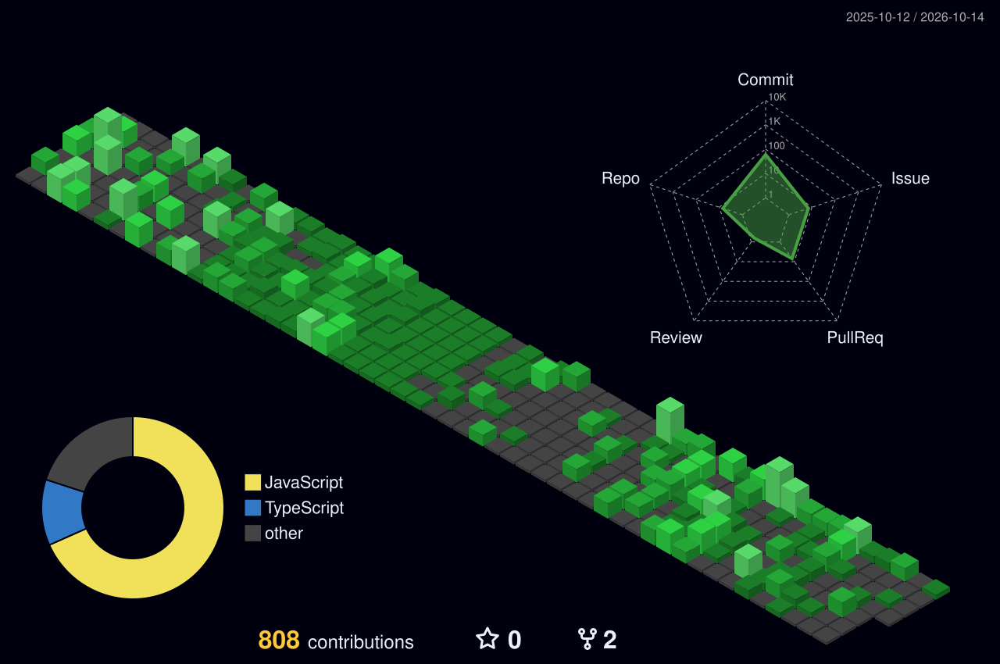

<h1>
  Yasir Akhlaque 
</h1>

> *"It's not who I am underneath, but what I build that defines me."*

```yaml
alias      : yasirakhlaque
role       : Full-Stack Engineer (Enhance AI)
focus      : End-to-End Type Safety, Scalable Architectures, High-Contrast UI
education  : B.E. in Computer Science & Engineering (IET Agra)
philosophy : Dysfunctional interfaces plague the web. I engineer them a better existence.

```

### The Utility Belt

<div align="left">
  
  
  
  
  
  
  
  
  
  
  
  
  
  
  
  
  
  
  
  
  
  
  
  
  
  
  
  
  
</div>

### The Case Files
*Actual problems, tangible solutions.*

| Dossier | Stack | Operational Summary |
| --- | --- | --- |
| **[IET-Connect](https://iet-connect.online/)** | `MongoDB` `Express` `React` `Node.js` | Centralized academic resource network built to eliminate exam-prep friction for university students sharing papers and notes. |
| **[Prompton](https://yasirdev.in)** | `Next.js` `TypeScript` `PostgreSQL` `Prisma` `Better Auth` | Community-driven AI prompt engineering repository for discovering, storing, and testing image generation parameters. |
| **[Job Tracker](https://jobtracker.yasirdev.in/)** | `Next.js` `TypeScript` `MongoDB` `Prisma` `Zod` | Structured pipeline tool engineered to bring order to the chaos of high-volume technical job applications. |
| **[Shopeaze](https://shopeaze.yasirdev.in/)** | `Next.js` `TypeScript` `Tailwind` | Rapid billing and inventory management engine built inside a 36-hour hackathon window for local retail operators. |

### Directives in Effect

* **Production Engineering:** Architecting full-stack AI tooling at **Enhance AI** using Next.js, tRPC, Prisma, and PostgreSQL. Previously built frontend systems at **PitchX**.
* **Open Source Maintenance:** 40+ merged Pull Requests across **Hacktoberfest** and **Social Winter of Code (SWoC)**, including active contributions to projects like *BentoPDF*.
* **Core Fundamentals:** Grinding algorithmic efficiency in C++ and exploring Ubuntu Linux.

### The Batcomputer

<div align="center">
  
</div>

### Signal The Bat
Got a complex system to architect, a product to ship, or just want to talk tech? Send up the signal.

```bash
$ curl -X POST [https://yasirdev.in/contact](https://yasirdev.in/contact) \
  --header "LinkedIn: [linkedin.com/in/yasirakhlaque](https://linkedin.com/in/yasirakhlaque)" \
  --data "status=ready_to_build"

```

###
## Activity Grid 🌟


[](https://holopin.io/@yasirakhlaque)
